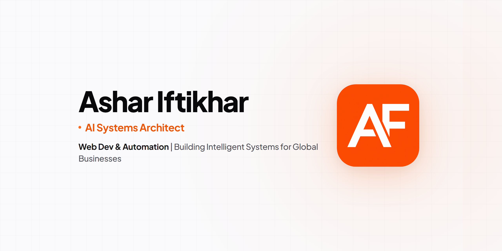

<div align="center">

# ⚡ Ashflow Automation Growth Stack

### Production-Grade n8n Workflows for Autonomous B2B Lead Gen, Qualification, CRM Sync & Reputation Velocity

[](https://ashflow.site)
[](https://n8n.io)
[](https://opensource.org/licenses/MIT)
[](https://ashflow.site/book-audit)

<br/>



<br/>
<br/>

**The open-source automation blueprint engineered for high-growth agencies, B2B SaaS, and modern service firms.** Built, tested, and maintained by the engineers at [Ashflow](https://ashflow.site).

</div>

---

## 🧭 Executive Overview

The **Ashflow Automation Growth Stack** eliminates manual pipeline friction by chaining together enterprise-grade automation primitives. Instead of fragmented Zapier zaps or brittle single-purpose scrapers, this repository provides:

- **Battle-Tested Node Graphs**: Full `workflow.json` files validated against the n8n core schema.
- **AI-Powered Decisioning**: OpenAI GPT-4o-mini structured qualification pipelines.
- **Edge SQL Data Replication**: Sub-millisecond deduplication and synchronization with Turso (LibSQL) and Google Sheets.
- **Reputation Acceleration**: Proactive review routing directing 5-star clients to Google Maps while intercepting negative feedback privately.
- **Extensible JavaScript Modules**: Native n8n code nodes for phone normalization (ITU-T E.164) and email business domain extraction.

---

## 📁 Workflow Directory

Each template includes a ready-to-import `workflow.json` and comprehensive setup documentation:

| Template | Primary Flow | Core Integrations | Setup Time | Difficulty |
|---|---|---|---|---|
| [**Google Maps Email Scraper**](./templates/google-maps-email-scraper/) | Autonomous search query scraping → Regex extraction → B2B deduplication → Spreadsheet pipeline | `HTTP Request`, `Regex`, `Google Sheets` | 10 mins | Beginner |
| [**AI Receptionist Lead Booking**](./templates/ai-receptionist-lead-booking/) | Webhook intake → OpenAI structured qualification → Google Calendar booking → Slack real-time alert | `Webhook`, `OpenAI GPT-4o`, `Google Calendar`, `Slack` | 15 mins | Intermediate |
| [**Post-Service Review Booster**](./templates/post-service-review-booster/) | Service completion trigger → 1-click sentiment survey → Google Maps review routing vs. private management escalation | `Webhook`, `Email (SMTP)`, `Google Maps`, `Slack` | 12 mins | Beginner |
| [**CRM Bi-Directional Sync**](./templates/crm-bidirectional-sync/) | Webhook listener → SHA-256 dedupe key → Turso Edge SQLite query → Atomic dual-sync with Google Sheets | `Webhook`, `Turso (LibSQL)`, `Google Sheets`, `Crypto` | 15 mins | Intermediate |

---

## 🧰 Production Code Modules & Utilities

Ready-to-use snippets engineered specifically for the n8n **Code Node**:

| Module | Location | Purpose |
|---|---|---|
| **Email Normalizer & Domain Extractor** | [`modules/lead-enrichment/email-normalizer.js`](./modules/lead-enrichment/email-normalizer.js) | RFC 5322 syntax validation, consumer freemail detection (Gmail, Yahoo, etc.), disposable domain filtering, and company brand inference. |
| **Phone Validator & E.164 Normalizer** | [`modules/lead-enrichment/phone-validator.js`](./modules/lead-enrichment/phone-validator.js) | Sanitizes messy international phone strings and formats into compliant ITU-T E.164 standards (`+14035550192`). |

---

## 🚀 Quickstart: Importing Workflows into n8n

### Option A: Via n8n Graphical Interface (Cloud or Self-Hosted)
1. Clone or download this repository:
   ```bash
   git clone https://github.com/ashariftikhar/automation-growth-stack.git
   ```
2. Log into your n8n workspace (`https://<your-instance>.app.n8n.cloud` or `http://localhost:5678`).
3. Navigate to **Workflows** in the left sidebar.
4. Click the **`+ Add workflow`** button in the top right.
5. Click the three dots menu (**`⋮`**) in the top right header → Select **Import from File**.
6. Select any `workflow.json` from the `templates/` folder (e.g. `templates/ai-receptionist-lead-booking/workflow.json`).
7. The complete node topology, expressions, and branches will render on your canvas.

### Option B: Via n8n CLI (Self-Hosted Docker)
If you manage n8n via Docker or server terminal:
```bash
# Import a specific workflow directly into your database
n8n import:workflow --input=./templates/ai-receptionist-lead-booking/workflow.json
```

---

## 🧪 Automated Workflow Validation

This repository includes a strict CLI validator that inspects every `workflow.json` for valid JSON syntax, required n8n node attributes, coordinate arrays, and connection topology:

```bash
# Run validation suite
node scripts/validate-workflows.js

# Or via npm script
npm run validate
```

### Validation Matrix
```text
✔ PASS AI Receptionist Lead Booking             [10 nodes | 9 connections]
✔ PASS CRM Bi-Directional Sync with Turso       [11 nodes | 10 connections]
✔ PASS Google Maps Email Scraper                [15 nodes | 15 connections]
✔ PASS Post-Service Review Booster              [13 nodes | 11 connections]

🚀 All workflows passed validation successfully!
```

---

## 🔐 Credentials Checklist

Before activating workflows in production, ensure your n8n credentials store has the following connected:

- [ ] **OpenAI API**: For structured prompt extraction and lead qualification.
- [ ] **Google OAuth2**: Authorized for Google Sheets (`https://www.googleapis.com/auth/spreadsheets`) and Google Calendar (`https://www.googleapis.com/auth/calendar`).
- [ ] **Slack Bot OAuth Token**: For `#leads-qualified`, `#customer-love`, and `#management-escalations`.
- [ ] **Turso Auth Token**: Set `TURSO_DATABASE_URL` and `TURSO_AUTH_TOKEN` in n8n environment variables.
- [ ] **SMTP / Transactional Email**: For customer review invitations and service recovery outreach.

---

## 🏢 Enterprise Custom Solutions & Consulting

Building a proprietary outbound growth machine, custom AI phone agent, or multi-tenant CRM infrastructure?

The team at **Ashflow** engineers custom enterprise automations for high-velocity teams:
- Custom API bridges & data enrichment pipelines (Apollo, Clay, Clearbit, Hunter)
- Multi-channel voice receptionist workflows (Vapi, Bland.ai, Retell)
- End-to-end RevOps synchronization across HubSpot, Salesforce, and data warehouses

👉 **[Book a Strategy Audit with Ashflow](https://ashflow.site/book-audit)** to map out your high-ROI automation roadmap.

---

## 📄 License & Community

This project is open-source under the [MIT License](./LICENSE). You are free to modify, distribute, and implement these workflows in personal or commercial projects.

- **Found an issue or have an optimization?** [Open a Pull Request](https://github.com/ashariftikhar/automation-growth-stack/pulls) or report a bug.
- **Maintained By:** [Ashflow Engineering](https://ashflow.site)
